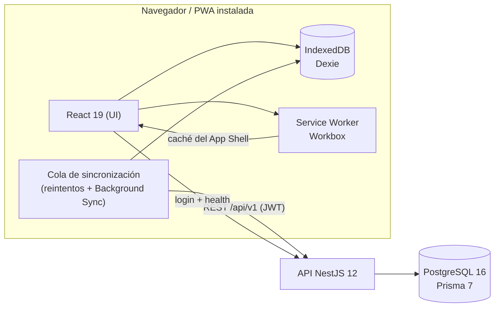

# FieldReport: arquitectura e implementación

PWA *offline-first* para que técnicos de campo levanten reportes de servicio sin señal. La app **nunca espera a la red**: lee y escribe en el teléfono (IndexedDB) y sincroniza con el servidor cuando hay conexión.

## Vista general



| Capa | Tecnología | Responsabilidad |
| --- | --- | --- |
| `apps/web` | React 19, Vite 8, Tailwind 4, Dexie | UI, datos locales, cola de sincronización, Service Worker propio (`src/sw.ts`) |
| `apps/api` | NestJS 12, Prisma 7, PostgreSQL 16 | Login, CRUD de reportes, idempotencia, Swagger en `/api/docs` |
| `packages/shared` | Zod 4 | Esquemas y mensajes de validación **únicos** para web y API |

## Cómo funciona el modo offline

1. **App Shell.** El Service Worker precachea HTML, JS, CSS e íconos en la primera visita; toda navegación de la SPA se resuelve con `index.html` del caché. Lo que no es SPA y falla sin red devuelve `/offline.html`.
2. **Datos.** Crear, editar o borrar un reporte escribe en IndexedDB con `syncState = pending` y un `clientId` (UUID) generado en el teléfono. La lista de reportes del servidor usa *NetworkFirst* (red, y tras 3 s la última copia).
3. **Sincronización.** Se dispara al volver la red (`online`), con un barrido periódico mientras la app está abierta y con **Background Sync** en Chromium (también con la app cerrada). Un *lock* (`navigator.locks`) evita que la pestaña y el SW envíen lo mismo a la vez.
4. **Reintentos.** Fallo de red o 5xx → *backoff* exponencial, máximo 5 intentos y luego `error` (botón "Sincronizar ahora" para reintentar). Un 4xx (salvo 408 y 429) no se reintenta, porque fallaría igual. Un 401 pide iniciar sesión sin tocar los reportes locales.
5. **Sin duplicados.** `Report.clientId` es único en PostgreSQL: reenviar el mismo reporte devuelve el existente en vez de crear otro.
6. **Indicador de red.** `navigator.onLine` solo dice que hay una interfaz de red, no que haya internet. Por eso la etiqueta *En línea / Sin conexión* confirma pidiendo `GET /api/v1/health` (cada 15 s, tiempo máximo 5 s) y baja de inmediato con el evento `offline` (`src/pwa/useOnline.ts`).

## Modelo de datos

- **Cliente (IndexedDB `fieldreport`)**: `reports` (clave `clientId`; incluye `syncState`, `retryCount`, `nextRetryAt`, `lastError`, `serverId`) y `meta` (`token`, `expired`). El token vive aquí y no en `localStorage` porque el SW también lo necesita.
- **Servidor (PostgreSQL)**: `User` (`email` único, `passwordHash` con scrypt, `role`) y `Report` (`clientId` único, `technicianId`, cliente, tipo de servicio, descripción, estatus, latitud/longitud opcionales, `createdAtClient` = hora real de captura, `syncedAt`). Índice `(technicianId, createdAtClient)`. Migraciones en `apps/api/prisma/migrations`.

## API (`/api/v1`)

`POST /auth/login` · `GET /health` · `POST /reports` (idempotente) · `GET /reports` · `GET/PUT/DELETE /reports/:id`. Todo lo de `/reports` exige `Authorization: Bearer <JWT>` (7 días) y solo ve los reportes del propio técnico. La validación usa el esquema de `packages/shared`, con mensajes en español.

## Seguridad

CSP estricta (`default-src 'self'`, sin `eval`: Zod va en modo `jitless`), HSTS, `X-Frame-Options: DENY`, `Permissions-Policy` (solo geolocalización propia), contraseñas con scrypt y comparación en tiempo constante, caché de la API borrado al cerrar sesión.

## Entornos

| Entorno | Cómo | Dónde |
| --- | --- | --- |
| Desarrollo | `docker compose up` | web `http://localhost:5173`, API `http://localhost:3000` |
| Producción local | `docker compose -f docker-compose.prod.yml up --build` | `http://localhost:8080` (nginx + API compilada) |
| Producción | Vercel (web) + Render (API y PostgreSQL) | `https://pwa-web-dun.vercel.app`; Vercel reescribe `/api/*` hacia Render, así web y API comparten origen |

## Acceso a la base de datos local

Hay **dos** bases locales y ninguna necesita instalar nada más que Docker:

### 1. PostgreSQL del contenedor (DBeaver / psql)

```bash
docker compose up -d db        # el puerto 5433 solo escucha en 127.0.0.1
```

DBeaver → *Nueva conexión* → **PostgreSQL**:

| Campo | Valor |
| --- | --- |
| Host | `localhost` |
| Puerto | `5433` (no `5432`: ahí suele haber otro Postgres del equipo) |
| Base de datos | `fieldreport` |
| Usuario | `fieldreport` |
| Contraseña | `fieldreport` |

Son los valores de `DB_USER`, `DB_PASSWORD` y `DB_NAME` en `.env` (copia de `.env.example`); si los cambias allí, cámbialos también en DBeaver. Por consola: `PGPASSWORD=fieldreport psql -h 127.0.0.1 -p 5433 -U fieldreport -d fieldreport`.

Tablas: `"User"`, `"Report"` y `_prisma_migrations`. Los nombres van entre comillas dobles porque Prisma los crea con mayúscula: `SELECT * FROM "Report" ORDER BY "syncedAt" DESC;`.

El usuario de la app (no es el de la base de datos) lo crea la API al arrancar con `DEMO_EMAIL` / `DEMO_PASSWORD` del `.env`: `tecnico@fieldreport.test` / `demo1234` en local.

### 2. IndexedDB del navegador (lo que ve la app sin red)

Sin usuario ni contraseña: DevTools → *Application* → *IndexedDB* → `fieldreport` → `reports`. Aquí se ven los reportes con su `syncState` antes de llegar a PostgreSQL.

## Limitaciones

Fotos y firma (RF-03, RF-04) no están implementadas. Background Sync solo existe en Chromium; en Safari/iOS sincroniza al abrir la app. Render gratuito se duerme tras 15 min: la primera petición tarda cerca de un minuto y, mientras tanto, la etiqueta puede mostrar *Sin conexión*.
